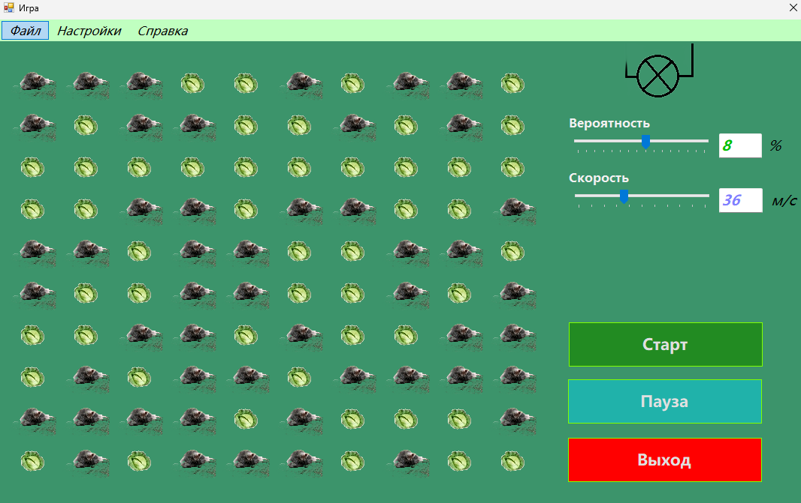
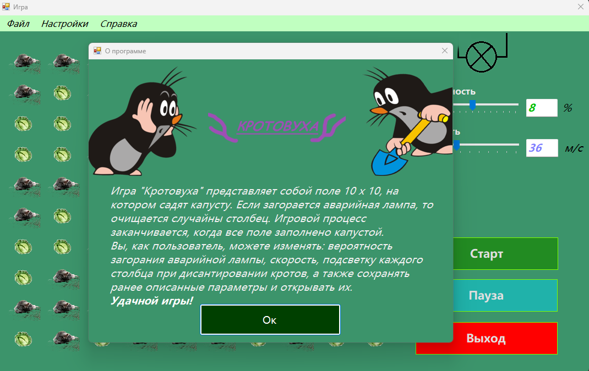
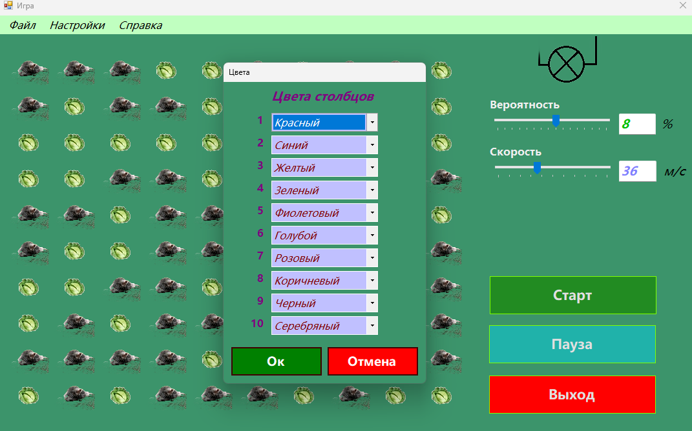
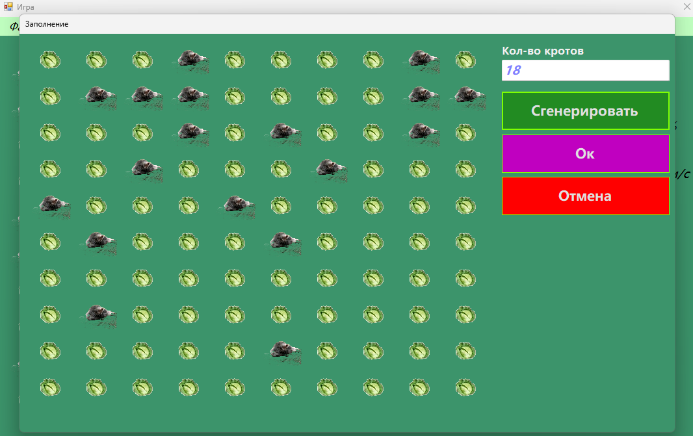
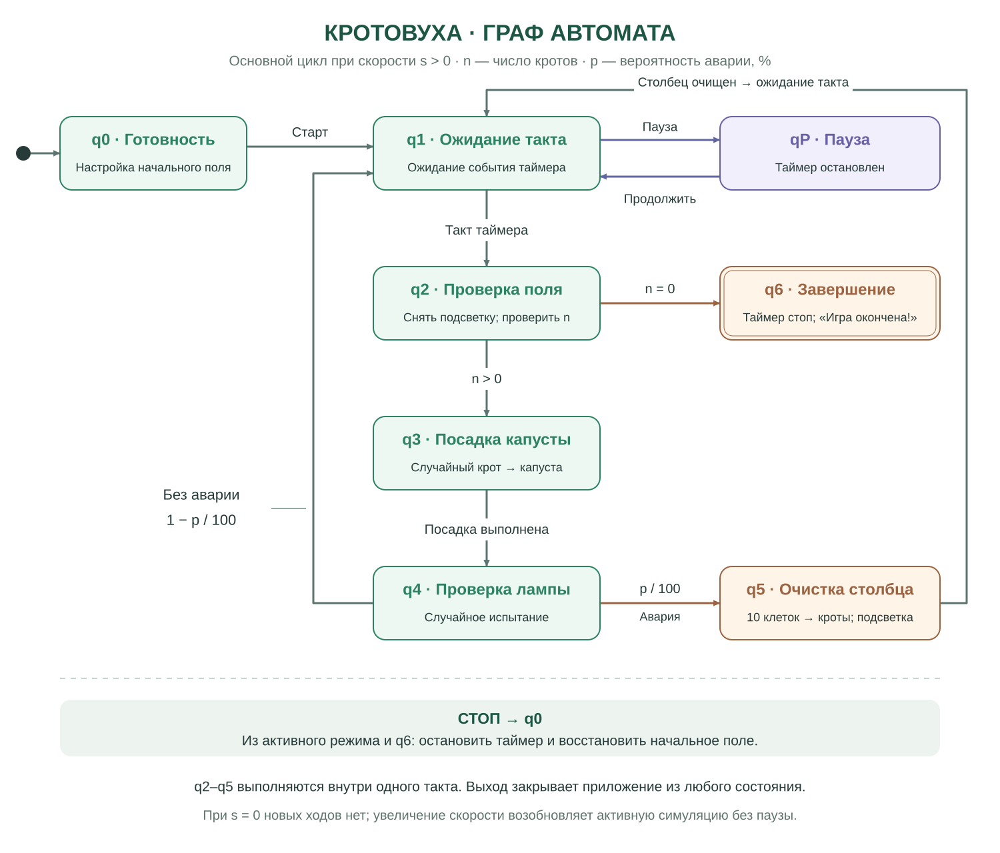
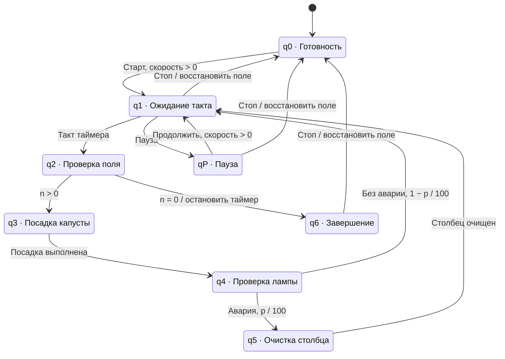

# Кротовуха · теория автоматов

**«Кротовуха»** — учебная игра-симуляция на C# и Windows Forms. На поле **10 × 10** клетки с кротами постепенно заменяются капустой. Случайное срабатывание аварийной лампы очищает целый столбец, возвращая в него кротов. Цель симуляции — заполнить капустой всё поле.



## Возможности

- Запуск, пауза, продолжение и остановка симуляции.
- Настройка вероятности аварии и скорости работы.
- Выбор цвета подсветки для каждого из десяти столбцов.
- Генерация начального поля с заданным количеством кротов и ручное редактирование клеток.
- Сохранение и загрузка начального поля, палитры, скорости и вероятности.
- Окна справки о программе и авторе.

## Запуск

### Исполняемый файл
В корне проекта лежит папка `Release`, которая содержит `.exe` файл программы и служебные файлы.

### Через Visual Studio

1. Установите Visual Studio с рабочей нагрузкой **«Разработка классических приложений .NET»** и компонентами разработки для **.NET Framework 4.7.2**.
2. Откройте решение [`Krotovukha-Game.slnx`](Krotovukha-Game/Krotovukha-Game.slnx) в версии Visual Studio с поддержкой `.slnx`. Можно также открыть [`Krotovukha-Game.csproj`](Krotovukha-Game/Krotovukha-Game/Krotovukha-Game.csproj) напрямую.
3. Восстановите пакеты NuGet для решения. Проект использует **Newtonsoft.Json 13.0.4**.
4. Соберите проект и запустите его клавишей **F5** или **Ctrl + F5**.

### Через MSBuild

После восстановления NuGet-пакетов выполните из корня репозитория в Developer PowerShell for Visual Studio:

```powershell
MSBuild .\Krotovukha-Game\Krotovukha-Game\Krotovukha-Game.csproj /t:Build /p:Configuration=Release
```

Приложение появится в `Krotovukha-Game/Krotovukha-Game/bin/Release/Krotovukha-Game.exe`. Папка `img` копируется рядом с исполняемым файлом при сборке; она нужна для отображения клеток и окон справки.

## Правила симуляции

При запуске приложения создаётся случайное поле из **50 кротов и 50 кочанов капусты**. Начальную расстановку можно заменить через меню **Настройки → Заполнение** или загрузить из файла.

Один такт выполняется в следующем порядке:

1. Снимается подсветка столбца от предыдущего такта.
2. Проверяется количество кротов. Если их нет, таймер останавливается и появляется сообщение **«Игра окончена!»**.
3. Если кроты остались и таймер включён, случайная клетка с кротом заменяется капустой.
4. Проверяется срабатывание аварийной лампы с заданной вероятностью.
5. При аварии выбирается один из десяти столбцов: все его клетки становятся кротами и подсвечиваются назначенным цветом. Без аварии лампа гаснет.

Заполненность проверяется **в начале следующего такта**. Поэтому после посадки последнего кочана ещё может сработать лампа и очистить столбец.

## Управление

| Элемент | Действие |
| --- | --- |
| **Старт / Стоп** | Запускает симуляцию; повторное нажатие останавливает её и восстанавливает начальное поле. |
| **Пауза / Продолжить** | Останавливает таймер и возобновляет выполнение. |
| **Выход** | Закрывает приложение. |
| **Вероятность** | Настраивает вероятность аварии в диапазоне **0–15 %**. |
| **Скорость** | Задаёт значение **0–100**, по которому рассчитывается интервал таймера. |
| **Файл → Открыть / Сохранить** | Загружает или сохраняет параметры и начальное поле. |
| **Настройки → Цвета** | Открывает настройку цветов десяти столбцов. |
| **Настройки → Заполнение** | Открывает генератор и редактор начального поля. |
| **Справка → О программе / Об авторе** | Показывает справочные окна. |

При положительной скорости `s` интервал таймера вычисляется как `floor(1000 / s) + 15` миллисекунд. При `s = 0` таймер остановлен: нажатие «Старт» не выполняет посадку капусты. Увеличение скорости возобновляет активную симуляцию, если она не поставлена на паузу. Надпись «м/с» в интерфейсе сохранена из исходного проекта; фактическое выполнение определяется интервалом таймера.

В обычном режиме запущенной симуляции меню **Файл** и **Настройки** недоступны до нажатия **Стоп**.

## Экранные формы

### О программе

Краткое описание игры и её правил.



### Цвета столбцов

Для каждого столбца выбирается цвет аварийной подсветки. **Ок** применяет выбранную палитру, **Отмена** закрывает окно с восстановлением выбора по сохранённой палитре.



### Заполнение поля

Введите количество кротов **от 1 до 99** и нажмите **Сгенерировать**. Расстановку можно менять щелчками по клеткам: крот заменяется капустой и наоборот. Редактор сохраняет хотя бы одного крота на поле. **Ок** применяет расстановку, **Отмена** возвращает редактор к текущему начальному полю.



## Граф автомата

Ниже приведена укрупнённая модель управляющего автомата для основного сценария: запуск при положительной скорости, такты таймера, пауза и остановка. Обозначения: `n` — количество кротов перед посадкой, `p` — заданная вероятность аварии в процентах.



| Состояние | Назначение |
| --- | --- |
| **q0 — Готовность** | Начальное поле доступно для настройки. |
| **q1 — Ожидание такта** | Симуляция ожидает событие таймера. |
| **q2 — Проверка поля** | Снимается предыдущая подсветка и проверяется наличие кротов. |
| **q3 — Посадка капусты** | Один случайный крот заменяется капустой. |
| **q4 — Проверка лампы** | Определяется, произошло ли аварийное событие. |
| **q5 — Очистка столбца** | Лампа включается, случайный столбец заполняется кротами и подсвечивается. |
| **q6 — Завершение** | Таймер остановлен, выведено сообщение об окончании игры. |
| **qP — Пауза** | Таймер остановлен до продолжения. |

Переход **Стоп** из активного режима или состояния завершения возвращает автомат в `q0` и восстанавливает начальное поле. **Выход** закрывает приложение из любого состояния. Состояния обработки `q2–q5` выполняются внутри одного обработчика таймера.

При нулевой скорости автомат ожидает без новых ходов. Схема показывает основные управляющие состояния; полное состояние приложения также включает расстановку клеток, начальное поле, параметры и флаги управления.

Файлы схемы: [SVG](docs/diagrams/automaton.svg), [PNG](docs/diagrams/automaton.png), [исходник Mermaid](docs/diagrams/automaton.mmd).

<details>
<summary>Исходник графа Mermaid</summary>



</details>

## Файлы настроек

Настройки сохраняются в **JSON**, по умолчанию с расширением `.txt`. Файл содержит:

- `Color0`–`Color9` — цвета десяти столбцов;
- `Speed` и `Probability` — скорость и вероятность аварии;
- `Field` — массив из 100 тегов начального поля: `krot` обозначает крота, `kacan` — капусту.

Сохраняется настроенная начальная расстановка. Изображения клеток во время симуляции могут отличаться от неё; кнопка **Стоп** возвращает поле к начальному состоянию.

## Структура проекта

```text
Krotovukha-Game/
├── Krotovukha-Game.slnx
└── Krotovukha-Game/
    ├── MainWindow.cs             # Главное окно и управление симуляцией
    ├── ColorSettingsForm.cs      # Выбор цветов столбцов
    ├── FieldEditorForm.cs        # Генератор и редактор поля
    ├── AboutGameForm.cs          # О программе
    ├── AuthorForm.cs             # Об авторе
    ├── Domain/                  # Игровое состояние и переходы поля
    ├── Presentation/            # Отображение, изображения, ввод и диалоги
    ├── Math/                    # Вероятность и интервал таймера
    ├── Settings/                # Модель настроек и JSON-сериализация
    ├── Properties/              # Ресурсы и свойства сборки
    └── img/                     # Изображения приложения
docs/
├── images/                      # Скриншоты экранных форм
└── diagrams/                    # Граф автомата в SVG, PNG и Mermaid
```

Стек: **C# · Windows Forms · .NET Framework 4.7.2 · Newtonsoft.Json**.
